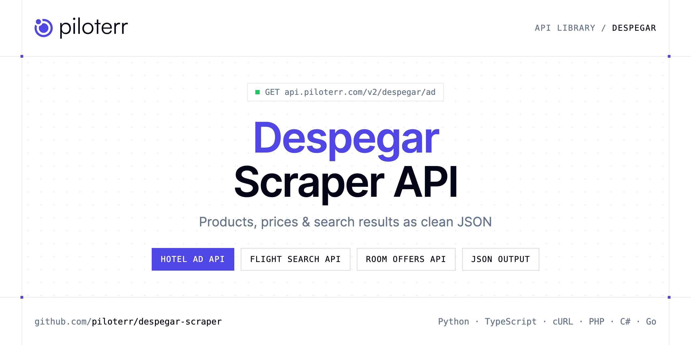

<p align="center">
  <a href="https://www.piloterr.com"></a>
</p>

# Despegar Scraper API

[](https://discord.gg/CFj3ph8aHU) [](https://app.piloterr.com) [](https://app.piloterr.com/openapi) [](LICENSE)

The **Piloterr Despegar Scraper API** lets you extract public data from Despegar as **clean, structured JSON** — no proxies, headless browsers or HTML parsing to maintain. Endpoints available in production:

- **Despegar Hotel Ad API** — Hotel detail from a Despegar accommodations detail URL.
- **Despegar Flight Search API** — Route fares from Despegar.
- **Despegar Room Offers API** — Room offers for one Despegar hotel and one stay.
- **Despegar Location Search API** — Resolve a city, airport or hotel name, or a Despegar results URL, to a destination id.
- **Despegar Hotel Search API** — Search Despegar hotels by city name or by an accommodations URL.

Use it for price monitoring, assortment tracking, competitor analysis, product research or catalog enrichment.

| Endpoint | Path | Credits | What you get |
|---|---|---|---|
| [Despegar Hotel Ad API](#despegar-hotel-ad-api) | `/v2/despegar/ad` | 2 | Hotel detail from a Despegar accommodations detail URL. The URL is fetched as-is. country does not rewrite it. |
| [Despegar Flight Search API](#despegar-flight-search-api) | `/v2/despegar/flight/search` | 2 | Route fares from Despegar. query is BUE-MAD, Buenos Aires - Madrid, or a flights URL such as https |
| [Despegar Room Offers API](#despegar-room-offers-api) | `/v2/despegar/hotel/rooms` | 2 | Room offers for one Despegar hotel and one stay. query is the accommodations detail URL, or the numeric hotel id together with check_in, check_out, and adults. status is ok when rooms are returned, no_availability when the night is sold out, and error when the page or the availability call fails. room_name is the Spanish name shown on despegar.com.ar, with nothing appended. room_id is Despegar's room identifier. Each offer can include price_list, price_logged_in, and price_mercado_pago in ARS with taxes included. A price is omitted when the site does not show it. board and cancellation are separate from the room name. |
| [Despegar Location Search API](#despegar-location-search-api) | `/v2/despegar/location/search` | 1 | Resolve a city, airport or hotel name, or a Despegar results URL, to a destination id. A results URL is reduced to the place id in the path, such as CIT_982. A detail URL that only contains a hotel number returns 400. return_page_source is not supported and returns 400. |
| [Despegar Hotel Search API](#despegar-hotel-search-api) | `/v2/despegar/search` | 2 | Search Despegar hotels by city name or by an accommodations URL. Dates are optional. If both are omitted, the stay is 3 nights starting 21 days from today. One date without the other, or a past date, returns 400. One call is one page of up to 21 hotels. |

## Table of contents

- [How it works](#how-it-works)
- [Despegar Hotel Ad API](#despegar-hotel-ad-api)
- [Despegar Flight Search API](#despegar-flight-search-api)
- [Despegar Room Offers API](#despegar-room-offers-api)
- [Despegar Location Search API](#despegar-location-search-api)
- [Despegar Hotel Search API](#despegar-hotel-search-api)
- [Code examples in other languages](#code-examples-in-other-languages)
- [Practical use cases](#practical-use-cases)
- [Why Piloterr?](#why-piloterr)
- [FAQ](#faq)
- [Official SDKs](#official-sdks)
- [Related scrapers](#related-scrapers)
- [Support](#support)

## How it works

1. **Create a free Piloterr account** and copy your API key from the [dashboard](https://app.piloterr.com).
2. **Send a `GET` (or `POST`) request** to `https://api.piloterr.com/v2/...` with the header `x-api-key: YOUR_API_KEY`.
3. **Receive structured JSON** — Piloterr handles rendering, proxies, retries and parsing.

```bash
export PILOTERR_API_KEY="your-api-key"
pip install requests        # Python
# TypeScript: Node.js 18+ (native fetch), run with `npx tsx file.ts`
```

> Every endpoint accepts both `GET` (query string) and `POST` (JSON body with the same fields).

## Despegar Hotel Ad API

Hotel detail from a Despegar accommodations detail URL. The URL is fetched as-is. country does not rewrite it.

`GET | POST https://api.piloterr.com/v2/despegar/ad` · **2 credits per request** · [Full reference](https://app.piloterr.com/openapi)

### Request parameters

| Parameter | Type | Required | Description |
|---|---|---|---|
| `query` | string | ✅ | Required. Full Despegar detail URL. |
| `language` | string | — | Optional. Default es-AR. Aliases: es, en, pt, ar. If set, it wins over the locale implied by country. The detail URL itself is not rewritten. |
| `currency` | string | — | Optional. Three letters, for example ARS. Used only when the page does not show a currency. It does not change the URL. |
| `country` | string | — | Optional. Two-letter site code. The value sent is the code, for example ar. It does not change the proxy. It selects the site and sends the x-locale header. If language is set, language wins for the locale. A full URL in… |
| `return_page_source` | boolean | — | Optional. Default false. true returns {"result": html} instead of JSON. A Chrome, Brave, or Internet Explorer proxy error is still HTTP 500, and that error page is not returned. |

### Python example

```python
import json
import os
import requests

response = requests.get(
    "https://api.piloterr.com/v2/despegar/ad",
    headers={"x-api-key": os.environ["PILOTERR_API_KEY"]},
    params={
        "query": "https://www.despegar.com.ar/accommodations/detail/242503/2026-12-15/2026-12-18/2",
    },
    timeout=120,
)
response.raise_for_status()
data = response.json()

print(json.dumps(data, indent=2, ensure_ascii=False)[:2000])
```

### TypeScript example

```typescript
type DespegarHotelAd = {
  id?: string;
  url?: string;
  name?: string;
  rooms?: {
    id?: string;
    name?: string;
    capacity?: number;
    price_per_night?: number;
    free_cancellation?: boolean;
    breakfast_included?: boolean;
    cancellation_deadline?: unknown;
  }[];
  stars?: number;
  photos?: string[];
  rating?: number;
  address?: {
    city?: string;
    full?: string;
    country?: string;
    neighborhood?: string;
  };
  pricing?: {
    taxes?: number;
    currency?: string;
    total_price?: number;
    price_per_night?: number;
    free_cancellation?: boolean;
    breakfast_included?: boolean;
  };
  category?: string;
  location?: {
    lat?: number;
    lng?: number;
  };
  policies?: {
    parking?: string;
    pets_allowed?: boolean;
    smoking_allowed?: boolean;
  };
  amenities?: string[];
  thumbnail?: string;
  description?: string;
  rating_label?: string;
  check_in_time?: string;
  reviews_count?: number;
  check_out_time?: string;
};

const params = new URLSearchParams({
  "query": "https://www.despegar.com.ar/accommodations/detail/242503/2026-12-15/2026-12-18/2",
});

const response = await fetch(`https://api.piloterr.com/v2/despegar/ad?${params}`, {
  headers: { "x-api-key": process.env.PILOTERR_API_KEY! },
});
if (!response.ok) throw new Error(`Piloterr error ${response.status}: ${await response.text()}`);

const data = (await response.json()) as DespegarHotelAd;

console.log(JSON.stringify(data, null, 2).slice(0, 2000));
```

<details>
<summary><b>POST variant</b></summary>

```http
POST https://api.piloterr.com/v2/despegar/ad
x-api-key: YOUR_API_KEY
Content-Type: application/json

{"query": "https://www.despegar.com.ar/accommodations/detail/242503/2026-12-15/2026-12-18/2"}
```
</details>

### Output example

Example response from the API reference, abridged — real values depend on the page you scrape.

```json
{
  "id": "hotel-bsas-22741",
  "url": "https://www.despegar.com/hoteles/argentina/buenos-aires/alvear-palace-hotel/hotel/22741",
  "name": "Alvear Palace Hotel",
  "rooms": [
    {
      "id": "rm-deluxe-classic",
      "name": "Habitación Deluxe Clásica",
      "capacity": 2,
      "price_per_night": 184200,
      "free_cancellation": false,
      "breakfast_included": true,
      "cancellation_deadline": null
    }
  ],
  "stars": 5,
  "photos": [
    "https://photos.despegar.com/hotels/22741/1.jpg",
    "https://photos.despegar.com/hotels/22741/2.jpg"
  ],
  "rating": 9.3,
  "address": {
    "city": "Buenos Aires",
    "full": "Av. Alvear 1891, Recoleta, Buenos Aires, Argentina",
    "country": "Argentina",
    "neighborhood": "Recoleta"
  },
  "pricing": {
    "taxes": 110520,
    "currency": "ARS",
    "total_price": 921000,
    "price_per_night": 184200,
    "free_cancellation": false,
    "breakfast_included": true
  },
  "category": "Lujo",
  "location": {
    "lat": -34.5874,
    "lng": -58.3932
  },
  "policies": {
    "parking": "De pago",
    "pets_allowed": false,
    "smoking_allowed": false
  },
  "amenities": [
    "Wi-Fi gratis",
    "Restaurante"
  ],
  "thumbnail": "https://photos.despegar.com/hotels/22741/main.jpg",
  "description": "El Alvear Palace Hotel es el hotel de lujo más emblemático de Buenos Aires, ubicado en el corazón del barrio de Recoleta. Desde 1932, ofr…",
  "rating_label": "Excelente",
  "check_in_time": "15:00",
  "reviews_count": 1874,
  "check_out_time": "12:00"
}
```

### Response fields

| Field | Type | Description |
|---|---|---|
| `id` | string |  |
| `url` | string |  |
| `name` | string |  |
| `rooms[]` | object[] |  |
| `rooms[].id` | string |  |
| `rooms[].name` | string |  |
| `rooms[].capacity` | integer |  |
| `rooms[].price_per_night` | integer |  |
| `rooms[].free_cancellation` | boolean |  |
| `rooms[].breakfast_included` | boolean |  |
| `rooms[].cancellation_deadline` | object |  |
| `stars` | integer |  |
| `photos` | string[] |  |
| `rating` | number |  |
| `address` | object |  |
| `address.city` | string |  |
| `address.full` | string |  |
| `address.country` | string |  |
| `address.neighborhood` | string |  |
| `pricing` | object |  |
| `pricing.taxes` | integer |  |
| `pricing.currency` | string |  |
| `pricing.total_price` | integer |  |
| `pricing.price_per_night` | integer |  |
| `pricing.free_cancellation` | boolean |  |

## Despegar Flight Search API

Route fares from Despegar. query is BUE-MAD, Buenos Aires - Madrid, or a flights URL such as https://www.despegar.com.ar/vuelos/bue/mad/. Dates are checked but do not change the route page. A URL in query is fetched as-is.

`GET | POST https://api.piloterr.com/v2/despegar/flight/search` · **2 credits per request** · [Full reference](https://app.piloterr.com/openapi)

### Request parameters

| Parameter | Type | Required | Description |
|---|---|---|---|
| `query` | string | ✅ | IATA pair, city pair, or a Despegar flights URL. The value sent is the code or the page URL. |
| `depart` | string | — | Optional. YYYY-MM-DD, today or later. Checked only. The fares still come from the route page. A past date returns 400. |
| `return_date` | string | — | Optional. Send it only together with depart. It must be after depart. It does not switch the page to a dated shop search. |
| `adults` | number | — | Optional. Must be at least 1. The route page does not filter by passenger count. |
| `language` | string | — | Optional. Default es-AR. Aliases: es, en, pt, ar. |
| `currency` | string | — | Optional. Three letters. Used when a fare card does not show a currency. Fallback USD. |
| `country` | string | — | Optional. Two-letter site code. The value sent is the code, for example ar. It does not change the proxy. It selects the site and sends the x-locale header. If language is set, language wins for the locale. A full URL in… |
| `return_page_source` | boolean | — | Optional. Default false. true returns {"result": html} instead of JSON. A Chrome, Brave, or Internet Explorer proxy error is still HTTP 500, and that error page is not returned. |

### Python example

```python
import json
import os
import requests

response = requests.get(
    "https://api.piloterr.com/v2/despegar/flight/search",
    headers={"x-api-key": os.environ["PILOTERR_API_KEY"]},
    params={
        "query": "BUE-MAD",
    },
    timeout=120,
)
response.raise_for_status()
data = response.json()

print(json.dumps(data, indent=2, ensure_ascii=False)[:2000])
```

### TypeScript example

```typescript
type DespegarFlightSearch = {
  results?: {
    url?: string;
    price?: number;
    route?: string;
    airline?: string;
    currency?: string;
    price_display?: string;
  }[];
  pagination?: {
    next?: unknown;
    page?: number;
    per_page?: number;
    total_pages?: unknown;
    total_results?: unknown;
  };
};

const params = new URLSearchParams({
  "query": "BUE-MAD",
});

const response = await fetch(`https://api.piloterr.com/v2/despegar/flight/search?${params}`, {
  headers: { "x-api-key": process.env.PILOTERR_API_KEY! },
});
if (!response.ok) throw new Error(`Piloterr error ${response.status}: ${await response.text()}`);

const data = (await response.json()) as DespegarFlightSearch;

console.log(JSON.stringify(data, null, 2).slice(0, 2000));
```

<details>
<summary><b>POST variant</b></summary>

```http
POST https://api.piloterr.com/v2/despegar/flight/search
x-api-key: YOUR_API_KEY
Content-Type: application/json

{"query": "BUE-MAD"}
```
</details>

### Output example

Example response from the API reference, abridged — real values depend on the page you scrape.

```json
{
  "results": [
    {
      "url": "https://www.despegar.com.ar/shop/flights/results/roundtrip/BUE/MAD/",
      "price": 893,
      "route": "AEP - MAD",
      "airline": "Avianca",
      "currency": "USD",
      "price_display": "US$ 893"
    }
  ],
  "pagination": {
    "next": null,
    "page": 1,
    "per_page": 21,
    "total_pages": null,
    "total_results": null
  }
}
```

### Response fields

| Field | Type | Description |
|---|---|---|
| `results[]` | object[] |  |
| `results[].url` | string |  |
| `results[].price` | integer |  |
| `results[].route` | string |  |
| `results[].airline` | string |  |
| `results[].currency` | string |  |
| `results[].price_display` | string |  |
| `pagination` | object |  |
| `pagination.next` | object |  |
| `pagination.page` | integer |  |
| `pagination.per_page` | integer |  |
| `pagination.total_pages` | object |  |
| `pagination.total_results` | object |  |

## Despegar Room Offers API

Room offers for one Despegar hotel and one stay. query is the accommodations detail URL, or the numeric hotel id together with check_in, check_out, and adults. status is ok when rooms are returned, no_availability when the night is sold out, and error when the page or the availability call fails. room_name is the Spanish name shown on despegar.com.ar, with nothing appended. room_id is Despegar's room identifier. Each offer can include price_list, price_logged_in, and price_mercado_pago in ARS with taxes included. A price is omitted when the site does not show it. board and cancellation are separate from the room name.

`GET | POST https://api.piloterr.com/v2/despegar/hotel/rooms` · **2 credits per request** · [Full reference](https://app.piloterr.com/openapi)

### Request parameters

| Parameter | Type | Required | Description |
|---|---|---|---|
| `query` | string | ✅ | Required. Despegar detail URL, or the numeric hotel id. The value sent is the URL or the id, not an API URL. |
| `check_in` | string | — | Required when query is a hotel id. YYYY-MM-DD, today or later. Send it with check_out. |
| `check_out` | string | — | Required when query is a hotel id. YYYY-MM-DD, after check_in. |
| `adults` | number | — | Optional. Default 2. Used when query is a hotel id. The detail URL already contains the occupancy. |
| `country` | string | — | Optional. Two-letter site code, for example ar. It does not change the proxy and does not rewrite a detail URL. When query is only a hotel id, ar uses despegar.com.ar and mx uses despegar.com.mx. Any other code returns 4… |

### Python example

```python
import json
import os
import requests

response = requests.get(
    "https://api.piloterr.com/v2/despegar/hotel/rooms",
    headers={"x-api-key": os.environ["PILOTERR_API_KEY"]},
    params={
        "query": "https://www.despegar.com.ar/accommodations/detail/1612020/2026-12-15/2026-12-16/2",
    },
    timeout=120,
)
response.raise_for_status()
data = response.json()

print(json.dumps(data, indent=2, ensure_ascii=False)[:2000])
```

### TypeScript example

```typescript
type DespegarRoomOffers = {
  body?: {
    rooms?: {
      offers?: Record<string, unknown>[];
      room_id?: string;
      room_name?: string;
    }[];
    status?: string;
    check_in?: string;
    currency?: string;
    hotel_id?: string;
    check_out?: string;
  };
  name?: string;
  status?: number;
};

const params = new URLSearchParams({
  "query": "https://www.despegar.com.ar/accommodations/detail/1612020/2026-12-15/2026-12-16/2",
});

const response = await fetch(`https://api.piloterr.com/v2/despegar/hotel/rooms?${params}`, {
  headers: { "x-api-key": process.env.PILOTERR_API_KEY! },
});
if (!response.ok) throw new Error(`Piloterr error ${response.status}: ${await response.text()}`);

const data = (await response.json()) as DespegarRoomOffers;

console.log(JSON.stringify(data, null, 2).slice(0, 2000));
```

<details>
<summary><b>POST variant</b></summary>

```http
POST https://api.piloterr.com/v2/despegar/hotel/rooms
x-api-key: YOUR_API_KEY
Content-Type: application/json

{"query": "https://www.despegar.com.ar/accommodations/detail/1612020/2026-12-15/2026-12-16/2"}
```
</details>

### Output example

Example response from the API reference, abridged — real values depend on the page you scrape.

```json
{
  "body": {
    "rooms": [
      {
        "offers": [
          {}
        ],
        "room_id": "2779250",
        "room_name": "Habitación Doble Estándar"
      }
    ],
    "status": "ok",
    "check_in": "2026-12-15",
    "currency": "ARS",
    "hotel_id": "1612020",
    "check_out": "2026-12-16"
  },
  "name": "Available",
  "status": 200
}
```

### Response fields

| Field | Type | Description |
|---|---|---|
| `body` | object |  |
| `body.rooms[]` | object[] |  |
| `body.status` | string |  |
| `body.check_in` | string |  |
| `body.currency` | string |  |
| `body.hotel_id` | string |  |
| `body.check_out` | string |  |
| `name` | string |  |
| `status` | integer |  |

## Despegar Location Search API

Resolve a city, airport or hotel name, or a Despegar results URL, to a destination id. A results URL is reduced to the place id in the path, such as CIT_982. A detail URL that only contains a hotel number returns 400. return_page_source is not supported and returns 400.

`GET | POST https://api.piloterr.com/v2/despegar/location/search` · **1 credit per request** · [Full reference](https://app.piloterr.com/openapi)

### Request parameters

| Parameter | Type | Required | Description |
|---|---|---|---|
| `query` | string | ✅ | Required. Place name, or a Despegar results URL. The value sent is the name or the page URL, not an API URL. A results URL is reduced to the place id in the path. A detail URL with only a hotel number returns 400. |
| `language` | string | — | Optional. Default es-AR. Aliases: es, en, pt, ar. Unknown code returns 400. |
| `country` | string | — | Optional. Two-letter site code. The value sent is the code, for example ar. It does not change the proxy. It selects the site and sends the x-locale header. If language is set, language wins for the locale. A full URL in… |

### Python example

```python
import json
import os
import requests

response = requests.get(
    "https://api.piloterr.com/v2/despegar/location/search",
    headers={"x-api-key": os.environ["PILOTERR_API_KEY"]},
    params={
        "query": "Buenos Aires",
    },
    timeout=120,
)
response.raise_for_status()
data = response.json()

print(json.dumps(data, indent=2, ensure_ascii=False)[:2000])
```

### TypeScript example

```typescript
type DespegarLocationSearch = {
  results?: {
    iata?: string;
    label?: string;
    country?: string;
    dest_id?: string;
    latitude?: number;
    dest_type?: string;
    longitude?: number;
  }[];
};

const params = new URLSearchParams({
  "query": "Buenos Aires",
});

const response = await fetch(`https://api.piloterr.com/v2/despegar/location/search?${params}`, {
  headers: { "x-api-key": process.env.PILOTERR_API_KEY! },
});
if (!response.ok) throw new Error(`Piloterr error ${response.status}: ${await response.text()}`);

const data = (await response.json()) as DespegarLocationSearch;

console.log(JSON.stringify(data, null, 2).slice(0, 2000));
```

<details>
<summary><b>POST variant</b></summary>

```http
POST https://api.piloterr.com/v2/despegar/location/search
x-api-key: YOUR_API_KEY
Content-Type: application/json

{"query": "Buenos Aires"}
```
</details>

### Output example

Example response from the API reference, abridged — real values depend on the page you scrape.

```json
{
  "results": [
    {
      "iata": "BUE",
      "label": "Buenos Aires, Ciudad de Buenos Aires, Argentina",
      "country": "Argentina",
      "dest_id": "CIT_982",
      "latitude": -34.60546,
      "dest_type": "city",
      "longitude": -58.38199
    }
  ]
}
```

### Response fields

| Field | Type | Description |
|---|---|---|
| `results[]` | object[] |  |
| `results[].iata` | string |  |
| `results[].label` | string |  |
| `results[].country` | string |  |
| `results[].dest_id` | string |  |
| `results[].latitude` | number |  |
| `results[].dest_type` | string |  |
| `results[].longitude` | number |  |

## Despegar Hotel Search API

Search Despegar hotels by city name or by an accommodations URL. Dates are optional. If both are omitted, the stay is 3 nights starting 21 days from today. One date without the other, or a past date, returns 400. One call is one page of up to 21 hotels.

`GET | POST https://api.piloterr.com/v2/despegar/search` · **2 credits per request** · [Full reference](https://app.piloterr.com/openapi)

### Request parameters

| Parameter | Type | Required | Description |
|---|---|---|---|
| `query` | string | ✅ | Required. City name, or a Despegar accommodations URL. The value sent is the city or the page URL, not an API URL. |
| `check_in` | string | — | Optional. YYYY-MM-DD, today or later. Send it only together with check_out. |
| `check_out` | string | — | Optional. Must be after check_in when both are set. |
| `adults` | number | — | Optional. Default 2. Must be at least 1. |
| `children` | number | — | Optional. Default 0. |
| `children_ages` | string | — | Optional. Comma-separated ages, one per child. If children is set and this is empty, each child is 8. |
| `stars` | string | — | Optional. Keep hotels whose star count is exactly this value: 1, 2, 3, 4 or 5. Empty keeps every hotel on the page. |
| `currency` | string | — | Optional. Three letters, for example ARS. Used only when the card does not show a currency. It is not added to the URL. Prices on despegar.com.ar are usually ARS. |
| `sort_by` | string | — | Optional. price, review_score, or rating. Empty keeps the page order. Other values are ignored. |
| `max_results` | number | — | Optional. Keep only the first N hotels of this page. Empty returns the full page, up to 21. There is no default of 20. |
| `page` | number | — | Optional. Page number. Despegar returns up to 21 hotels per page. Default 1. |
| `language` | string | — | Optional. Default es-AR. Aliases: es, en, pt, ar. Unknown code returns 400. If set, it wins over the locale implied by country. |
| `country` | string | — | Optional. Two-letter site code. The value sent is the code, for example ar. It does not change the proxy. It selects the site and sends the x-locale header. If language is set, language wins for the locale. A full URL in… |
| `return_page_source` | boolean | — | Optional. Default false. true returns {"result": html} instead of JSON. A Chrome, Brave, or Internet Explorer proxy error is still HTTP 500, and that error page is not returned. |

### Python example

```python
import json
import os
import requests

response = requests.get(
    "https://api.piloterr.com/v2/despegar/search",
    headers={"x-api-key": os.environ["PILOTERR_API_KEY"]},
    params={
        "query": "Buenos Aires",
    },
    timeout=120,
)
response.raise_for_status()
data = response.json()

print(json.dumps(data, indent=2, ensure_ascii=False)[:2000])
```

### TypeScript example

```typescript
type DespegarHotelSearch = {
  id?: string;
  url?: string;
  name?: string;
  stars?: number;
  taxes?: number;
  rating?: number;
  address?: {
    city?: string;
    full?: string;
    country?: string;
    neighborhood?: string;
  };
  currency?: string;
  location?: {
    lat?: number;
    lng?: number;
    distance_to_center?: string;
  };
  amenities?: string[];
  thumbnail?: string;
  total_price?: number;
  rating_label?: string;
  reviews_count?: number;
  price_per_night?: number;
  free_cancellation?: boolean;
  breakfast_included?: boolean;
}[];

const params = new URLSearchParams({
  "query": "Buenos Aires",
});

const response = await fetch(`https://api.piloterr.com/v2/despegar/search?${params}`, {
  headers: { "x-api-key": process.env.PILOTERR_API_KEY! },
});
if (!response.ok) throw new Error(`Piloterr error ${response.status}: ${await response.text()}`);

const data = (await response.json()) as DespegarHotelSearch;

console.log(JSON.stringify(data, null, 2).slice(0, 2000));
```

<details>
<summary><b>POST variant</b></summary>

```http
POST https://api.piloterr.com/v2/despegar/search
x-api-key: YOUR_API_KEY
Content-Type: application/json

{"query": "Buenos Aires"}
```
</details>

### Output example

Example response from the API reference, abridged — real values depend on the page you scrape.

```json
[
  {
    "id": "hotel-bsas-22741",
    "url": "https://www.despegar.com/hoteles/argentina/buenos-aires/alvear-palace-hotel/hotel/22741?adults=2&rooms=1&checkin=2026-08-10&checkout=2026…",
    "name": "Alvear Palace Hotel",
    "stars": 5,
    "taxes": 110520,
    "rating": 9.3,
    "address": {
      "city": "Buenos Aires",
      "full": "Av. Alvear 1891, Recoleta, Buenos Aires, Argentina",
      "country": "Argentina",
      "neighborhood": "Recoleta"
    },
    "currency": "ARS",
    "location": {
      "lat": -34.5874,
      "lng": -58.3932,
      "distance_to_center": "2.1 km del centro"
    },
    "amenities": [
      "Wi-Fi gratis",
      "Restaurante"
    ],
    "thumbnail": "https://photos.despegar.com/hotels/22741/main.jpg",
    "total_price": 921000,
    "rating_label": "Excelente",
    "reviews_count": 1874,
    "price_per_night": 184200,
    "free_cancellation": false,
    "breakfast_included": true
  }
]
```

### Response fields

| Field | Type | Description |
|---|---|---|

## Code examples in other languages

Ready-to-run examples live in the [`examples/`](examples) folder. Each one reads your key from the `PILOTERR_API_KEY` environment variable.

| Language | Hotel Ad | Flight Search | Room Offers | Location Search | Hotel Search |
|---|---|---|---|---|---|
| cURL (Bash) | [`ad`](examples/curl/ad.sh) | [`flight-search`](examples/curl/flight_search.sh) | [`hotel-rooms`](examples/curl/hotel_rooms.sh) | [`location-search`](examples/curl/location_search.sh) | [`search`](examples/curl/search.sh) |
| PHP | [`ad`](examples/php/ad.php) | [`flight-search`](examples/php/flight_search.php) | [`hotel-rooms`](examples/php/hotel_rooms.php) | [`location-search`](examples/php/location_search.php) | [`search`](examples/php/search.php) |
| C# | [`ad`](examples/csharp/Ad.cs) | [`flight-search`](examples/csharp/FlightSearch.cs) | [`hotel-rooms`](examples/csharp/HotelRooms.cs) | [`location-search`](examples/csharp/LocationSearch.cs) | [`search`](examples/csharp/Search.cs) |
| Go | [`ad`](examples/go/ad.go) | [`flight-search`](examples/go/flight_search.go) | [`hotel-rooms`](examples/go/hotel_rooms.go) | [`location-search`](examples/go/location_search.go) | [`search`](examples/go/search.go) |
| Java | [`ad`](examples/java/AdExample.java) | [`flight-search`](examples/java/FlightSearchExample.java) | [`hotel-rooms`](examples/java/HotelRoomsExample.java) | [`location-search`](examples/java/LocationSearchExample.java) | [`search`](examples/java/SearchExample.java) |
| Ruby | [`ad`](examples/ruby/ad.rb) | [`flight-search`](examples/ruby/flight_search.rb) | [`hotel-rooms`](examples/ruby/hotel_rooms.rb) | [`location-search`](examples/ruby/location_search.rb) | [`search`](examples/ruby/search.rb) |
| Node.js | [`ad`](examples/nodejs/ad.mjs) | [`flight-search`](examples/nodejs/flight_search.mjs) | [`hotel-rooms`](examples/nodejs/hotel_rooms.mjs) | [`location-search`](examples/nodejs/location_search.mjs) | [`search`](examples/nodejs/search.mjs) |

## Practical use cases

- **Price monitoring** — Track prices, promotions and availability over time to react to competitors.
- **Assortment & catalog tracking** — Follow new products, delisted items and category changes.
- **Competitor analysis** — Benchmark ranges, brands and positioning across retailers.
- **Product research** — Spot best-sellers and trends from search results.
- **Catalog enrichment** — Pull titles, images and attributes into your PIM or marketplace listings.

## Why Piloterr?

- **No infrastructure** — no proxies, headless browsers or CAPTCHA solving to run yourself.
- **Structured JSON** — stable, documented fields instead of brittle HTML selectors.
- **Pay per request** — transparent credit cost per endpoint, failed requests are retried for you.
- **One API key, hundreds of sources** — Despegar plus many other e-commerce, search and company data endpoints in the [Piloterr library](https://www.piloterr.com/library).
- **Any language** — plain HTTPS + JSON, with examples for Python, TypeScript, cURL, PHP, C#, Go, Java, Ruby and Node.js.

## FAQ

### Is it legal to scrape Despegar?

Collecting publicly available data is generally allowed in many jurisdictions, but rules depend on your country, the data you collect and how you use it. Avoid personal data unless you have a lawful basis, respect the website's terms where they apply, and get legal advice for your specific use case. This is not legal advice.

### Do I need proxies or a headless browser?

No. Piloterr handles rendering, proxy rotation and retries on its side. You only send an HTTPS request with your `x-api-key` header and receive JSON.

### How much does a request cost?

Credits per call: `/v2/despegar/ad` **2**, `/v2/despegar/flight/search` **2**, `/v2/despegar/hotel/rooms` **2**, `/v2/despegar/location/search` **1**, `/v2/despegar/search` **2**. See the [Piloterr website](https://www.piloterr.com) for plans.

### What data does the Despegar API return?

Each endpoint returns structured JSON: **Despegar Hotel Ad** — `id`, `url`, `name`, `rooms[]`, `rooms[].id`, `rooms[].name`; **Despegar Flight Search** — `results[]`, `results[].url`, `results[].price`, `results[].route`, `results[].airline`, `results[].currency`; **Despegar Room Offers** — `body`, `body.rooms[]`, `body.status`, `body.check_in`, `body.currency`, `body.hotel_id`; **Despegar Location Search** — `results[]`, `results[].iata`, `results[].label`, `results[].country`, `results[].dest_id`, `results[].latitude`.

### How do I paginate Despegar results?

Use the `page` parameter and keep requesting while the response indicates more results.

### Can I target a specific country or language?

Yes, use `country`, `language` — see the parameter tables above for accepted values.

### Can I get the raw HTML instead of JSON?

Yes. Set `return_page_source=true` and the response becomes `{"result": "..."}` with the page source.

### Which languages are supported?

Any language that can make an HTTP request. This README shows Python and TypeScript; the [`examples/`](examples) folder contains cURL, PHP, C#, Go, Java, Ruby and Node.js.

## Official SDKs

Use Piloterr from your own language with a typed client:

| SDK | Package | Install |
| --- | --- | --- |
| Node.js | [`@piloterr/sdk`](https://www.npmjs.com/package/@piloterr/sdk) | `npm install @piloterr/sdk` |
| Python | [`piloterr`](https://pypi.org/project/piloterr/) | `pip install piloterr` |
| Go | [`piloterr-go`](https://pkg.go.dev/github.com/piloterr/piloterr-go) | `go get github.com/piloterr/piloterr-go` |
| .NET | [`Piloterr`](https://www.nuget.org/packages/Piloterr) | `dotnet add package Piloterr` |
| Ruby | [`piloterr`](https://rubygems.org/gems/piloterr) | `gem install piloterr` |
| PHP | [`piloterr/sdk`](https://packagist.org/packages/piloterr/sdk) | `composer require piloterr/sdk` |
| Java | [`piloterr-java`](https://github.com/piloterr/piloterr-java) | build from source, see its README |
| CLI | [`@piloterr/cli`](https://www.npmjs.com/package/@piloterr/cli) | `npm install -g @piloterr/cli` |
| MCP server | [`@piloterr/mcp`](https://www.npmjs.com/package/@piloterr/mcp) | `npx -y @piloterr/mcp` |

## Related scrapers

- [Jobs Scraper API](https://github.com/piloterr/jobs-scraper)
- [About You Scraper API](https://github.com/piloterr/aboutyou-scraper)
- [Action Scraper API](https://github.com/piloterr/action-scraper)
- [Aldi Scraper API](https://github.com/piloterr/aldi-scraper)
- [Alibaba Scraper API](https://github.com/piloterr/alibaba-scraper)
- [AliExpress Scraper API](https://github.com/piloterr/aliexpress-scraper)
- [All Piloterr scrapers on GitHub](https://github.com/piloterr)

## Support

- 💬 Join the [Piloterr Discord](https://discord.gg/CFj3ph8aHU) to ask questions and share what you build.
- 📚 Browse the [API reference (OpenAPI)](https://app.piloterr.com/openapi) and the [Piloterr library](https://www.piloterr.com/library).
- 🔑 [Get your API key](https://app.piloterr.com).

---

<p align="center">
  <a href="https://www.piloterr.com">
    <picture>
      <source media="(prefers-color-scheme: dark)" srcset="images/logo-dark.svg">
      
    </picture>
  </a>
  <br>
  <sub>Built by <a href="https://www.piloterr.com">Piloterr</a> — web scraping APIs for e-commerce, search, real estate and more, one API key.</sub>
</p>

<sub>Despegar is a trademark of its respective owner. This repository is not affiliated with or endorsed by Despegar. Examples are released under the MIT license.</sub>
